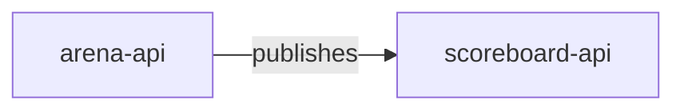
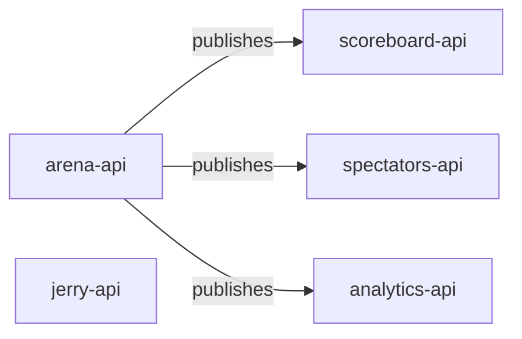

### Chronicle review

Graph v17 · based on commit 3f9e2c1 · 3/4 changed files covered (base: Graph v16 · commit c1eeeee)

**3 systems may be affected across 2 repositories.**

1 integration added · 1 dependency removed · 1 file has unknown impact

*Compact view: changed systems, what they touch, directly affected systems. Full impact graph in [Chronicle](https://chronicle.example/review/42).*

### Who may be affected

| System | Why | Path |
| --- | --- | --- |
| **analytics-api** analytics repository | the producer of `battle-results` changed | arena-api → battle-results → analytics-api |
| **scoreboard-api** | the producer of `battle-results` changed | arena-api → battle-results → scoreboard-api |
| **spectators-api** | the producer of `battle-results` changed | arena-api → battle-results → spectators-api |

### Changed system relationships

| Change | Relationship | Effect |
| --- | --- | --- |
| integration added | `arena-api` publishes `battle.critical-hit` | new event, no consumers yet |
| dependency removed | `arena-api` no longer calls `jerry-api` | `informational` `jerry-api` loses a caller |
| producer changed | `arena-api` publishes `battle-results` | 3 consumers may be affected |

#### Unknown impact (1 file)

`arena-api/src/arena/battle.gateway.ts` changed after its last scan. Chronicle does not know what the new code does. Scan it and run `chronicle graph update`.

Code changed, graph unchanged (1)

- `arena.controller` → `arena.service` (injects) · arena-api/src/arena/arena.controller.ts:31-44 · caller-side change, nothing downstream

Evidence (3 facts)

| Fact | Source | Confidence |
| --- | --- | --- |
| battle-result.producer publishes battle.critical-hit | arena-api/src/arena/battle-result.producer.ts:58-64 · blob 3f9e2c1 | 0.90 |
| jerry.client calls jerry-api (removed) | was arena-api/src/arena/jerry.client.ts:31-36 · blob 88ab017 | 0.85 |
| battle-result.producer publishes battle-results | arena-api/src/arena/battle-result.producer.ts:40-52 · blob 3f9e2c1 | 0.90 |

Full diagram and details

- **changed** integration added `arena-api → battle.critical-hit`
- **changed** producer changed `arena-api → battle-results`
  - **affected** producer changed `scoreboard-api` via battle-results
  - **affected** producer changed `spectators-api` via battle-results
  - **affected** producer changed `analytics-api` via battle-results
- **changed** dependency removed `arena-api → jerry-api`
  - **informational** dependency removed `jerry-api`
- **changed** consumer changed `arena-api → arena.service`
- **unknown** `arena-api/src/arena/battle.gateway.ts` (head_stale_file)

Deterministic review, no LLM · `chronicle review main...feat/critical-hits` · [JSON](https://chronicle.example/review/42.json) · [Open in Chronicle](https://chronicle.example/review/42)
